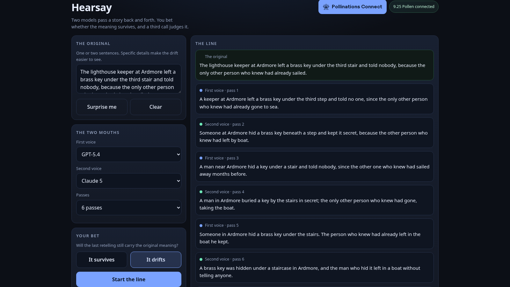

# Hearsay

Two [Pollinations](https://pollinations.ai) models pass a story back and forth until it stops being the same story. Before the line starts you bet whether the meaning survives, and a decision model judges the result.

**Live:** https://marcus-mok-gh.github.io/hearsay/

## How a round works

1. You write the original: one or two sentences, ideally with specifics that can be dropped or invented.
2. You pick two text models and a number of passes (4, 6 or 8).
3. You bet: does the meaning survive, or drift?
4. Each pass, the model whose turn it is receives only the previous retelling and passes it on in its own words, one or two sentences, adding and removing nothing.
5. `POST /alpha/decisions` then answers a single question with its own confidence and probability spread: does the final retelling still carry the core claim and specifics?

The models only talk and judge. Turn order, the chain, scoring and the streak are computed in code.

## Cost

One short text call per pass, one decision call per round. At six passes a round costs seven calls, all billed to the visitor's own Pollen.

## Bring your own Pollen

`<polli-connect>` with this app's publishable key, a 10 Pollen cap and 7 day expiry. `models="decision,text"` authorises the `decision` category that `POST /alpha/decisions` requires and the `text` models used for the passes.

## Run locally

Any static server works, for example `python3 -m http.server`, then open `index.html`. Nothing is built and nothing is bundled.

## Notes

- The app asks for no key of its own: without a connected visitor it explains what is missing instead of failing silently.
- 401 and 402 responses become plain-language notices.
- Wagers and streak live in `localStorage`; the chain itself is not stored.
